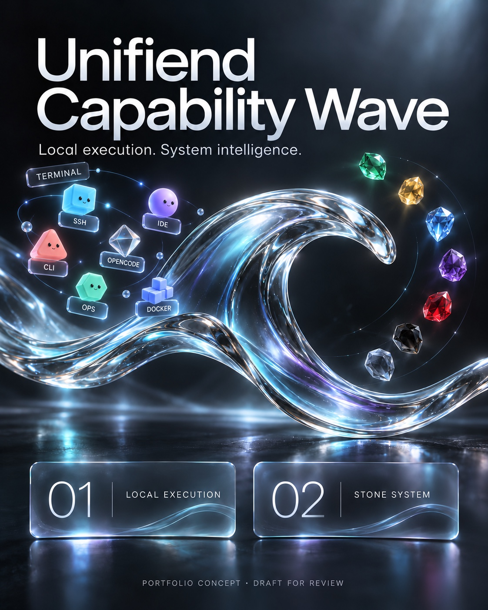

# Unifiend Capability Wave

Local execution. Autonomous flow.

Built 100% on mobile.

<!-- UNIFIEND_CAPABILITY_BADGES:START -->
## Workspace apps & capabilities

Built 100% on mobile. Operated through mobile, chat and commands.

These labels list workspace tools, registered routes and candidates. They do not certify live host status or remaining model credits.

### Core workspace

Core system services and command interfaces.

### Terminal & execution

Execution surfaces and tools. Host installation and invocation are checked separately.

### Models & agent routes

Registered routes and candidates. Authentication, entitlement and quota remain provider-specific.

### Design, research & delivery

Workspace connectors and artifact tools. Tool exposure does not imply a host adapter.

### Workflow & collaboration

Registered integrations, optional delivery services and the knowledge archive.

### 15 connector modes

Protocol and interface inventory. Individual end-to-end checks are recorded separately.

### Stone capabilities

Seven Stones, with Athena / White Diamond as the recording and task-classification layer.

<!-- UNIFIEND_CAPABILITY_BADGES:END -->

An Artificial Intelligence workspace connecting tools, execution and task continuity in one system. Operated from a phone through agents and commands, with system rules and audit review to collect evidence for internal certification.

## 01 · Local & Remote Execution

Terminal, SSH, IDE, CLI, OpenCode, Ops and Docker form the execution environment, with connections to Cloud services and external tools. Mobile, agent and command entry points come together in one workspace.

An internal team of 15 agents and tools handles assigned work.

## 02 · Stone System Model

1LSS, One-Line Session, provides one canonical continuity record for context, agreements, task state and verified outcomes across interfaces and tools.

Athena / White Diamond receives results and context from every destination, records working context, reasons and classifies tasks. Green Stone stores system memory in 1LSS on D1. Green has no planning, reasoning or execution role. Ruby verifies outcomes before they become certified evidence.

| Stone | Material | Function |
| --- | --- | --- |
| Green | Emerald | System memory only / 1LSS |
| Yellow | Citrine | Tools / API, MCP and SDK adapters |
| Blue | Blue Diamond | Agent identity and readiness |
| Violet | Amethyst | Multi-agent solution |
| Ruby | Ruby | Verification |
| Obsidian | Obsidian | Ephemeral runtime execution |
| Gray | Gray Agate | Central rule taxonomy |

The website is the Main Command interface for sending commands, selecting capabilities, assigning work, tracking status and reviewing results and evidence in one place.

CCS, Capability Card, is a 15-in-1 concept combining role, tools, task scope and credential references in one card. It matches capability types to Local or External destinations without exposing secret values.

Calling and fallback are presented as simulation paths for checking scope, access and destination compatibility. Results return to Athena for recording and classification, then to Green for storage.

15 connector categories: MCP · Workflow · REST API · Token · Secret · Credential · Repository / PR API · Agent API · Function / Tool Calling · NPX / CLI · NPM · SDK · A2A Relay · Webhook / Event · Agent Sign / Command / Run

## One Line Session - Local Extraction

Internal covers the command interface, scoped capability routing, Stones, local execution and Docker. External covers Cloud services, APIs, MCP endpoints and external tools. Both zones return result receipts to Athena. Athena writes memory to Green; Green never routes work back to Main Command.
